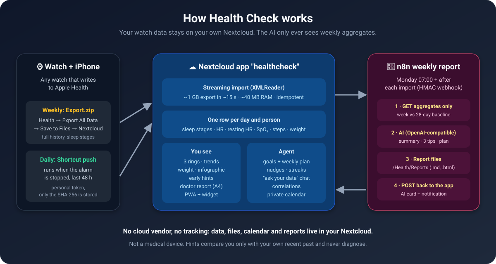
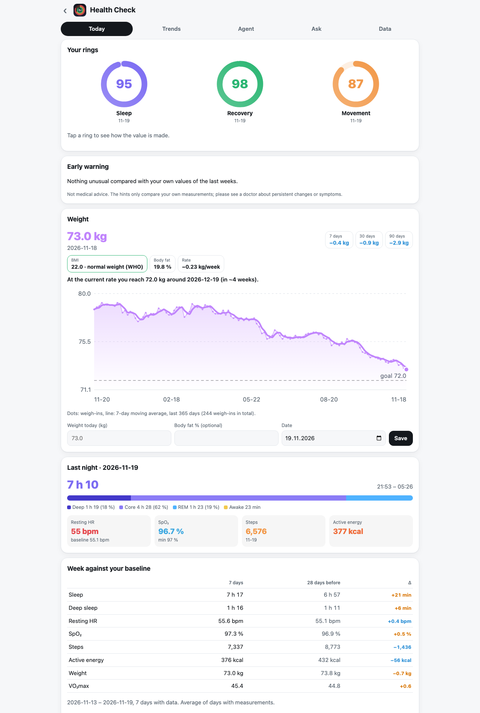
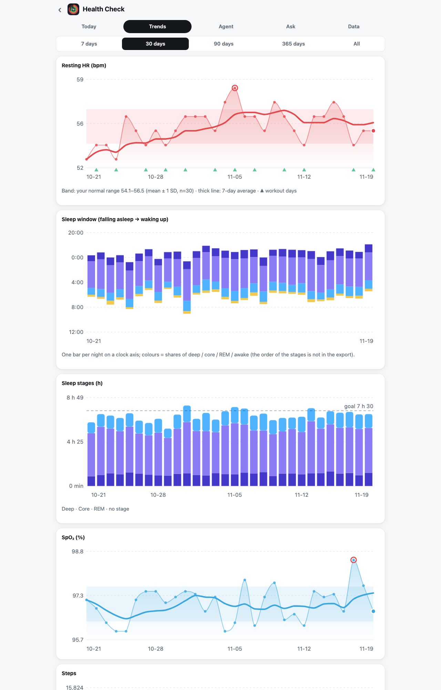
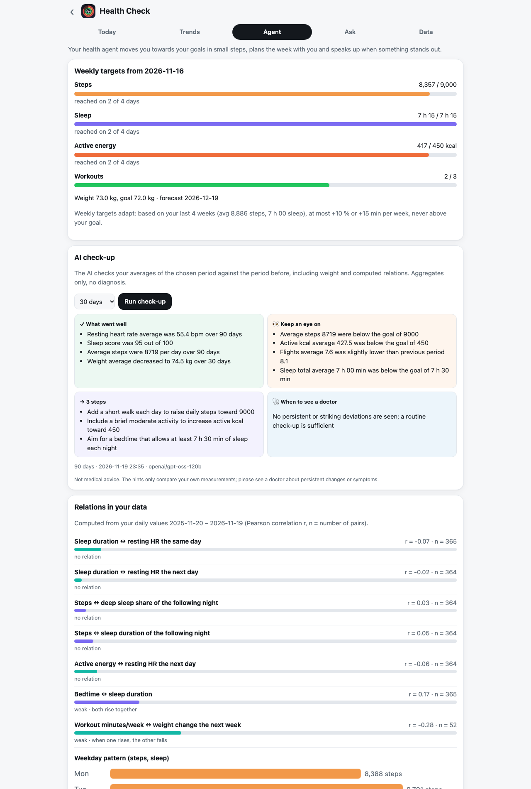
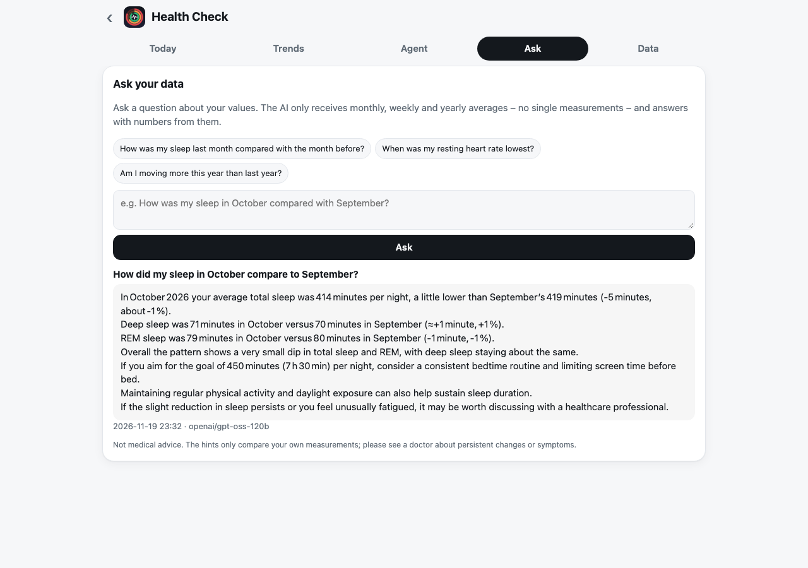
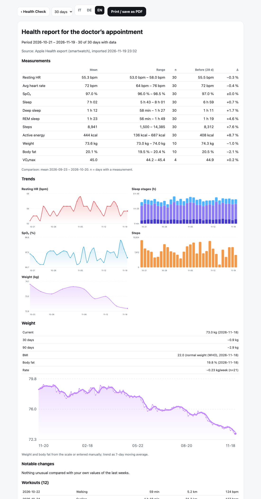
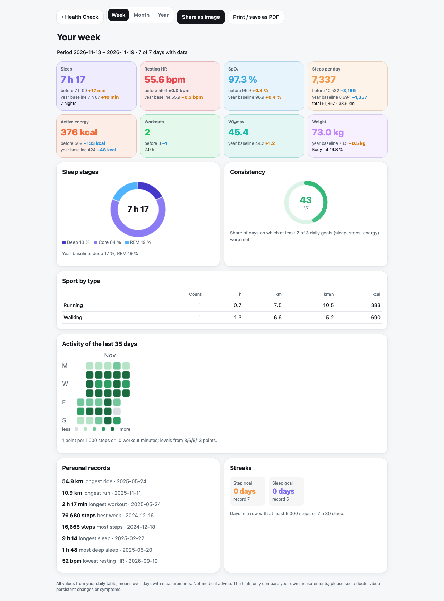
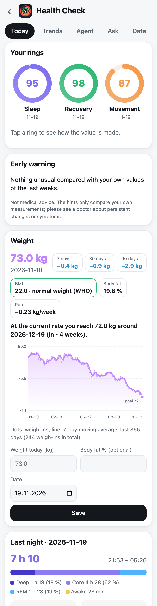

# Health Check – your private health agent inside Nextcloud

**Health Check** turns the Apple Health data of your iPhone and watch into a private health dashboard and agent inside
your own Nextcloud. Nothing goes to a vendor cloud: data, calendar, reports and AI summaries stay on your server.

Any watch that writes into Apple Health works. It was built and tested with a **Huawei Watch GT 5 Pro**
(Huawei Health → Apple Health), which has no usable open API for individuals.

**Article:** [Health Check: my smartwatch data in my own Nextcloud](https://daniele-michelin.com/en/blog/health-check-nextcloud/) (also in [German](https://daniele-michelin.com/blog/gesundheits-check-nextcloud/) and [Italian](https://daniele-michelin.com/it/blog/health-check-nextcloud/)) · author: [daniele-michelin.com](https://daniele-michelin.com/en/)

> **Not a medical device and not medical advice.** All hints compare you only with your own recent past and never diagnose.



## Screenshots

*All screenshots use a synthetic demo dataset (a fictional person, two years of generated data).*

| Today | Trends | Agent |
|---|---|---|
|  |  |  |

| Ask your data | Doctor report | Infographic | Phone |
|---|---|---|---|
|  |  |  |  |

## Features

- **Import that scales**: drop the weekly `Export.zip` into `/Health/Import`. A streaming parser reads a ~1 GB export in
  about 15 seconds with ~40 MB of memory. Re-imports never create duplicates.
- **Daily push from the iPhone**: an Apple Shortcut sends the last 48 hours every morning when you stop the alarm.
- **Three rings** (sleep, recovery, movement) with transparent formulas, **trend charts** with 7-day averages and your
  personal normal range, back to the first recorded day.
- **Tips for the week** without AI: sleep rhythm, weekend shift, load versus recovery, steps versus goal; always compared only with yourself.
- **Daily check-in**: one tap for energy (1–5) and a neutral link to your sleep after a few weeks.
- **Your data stays yours**: download everything as JSON or the daily table as CSV.
- **Weight** as a first-class metric: BMI, body fat, 7/30/90-day change, target weight with an ETA, manual weigh-ins.
- **Early hints** (elevated resting heart rate, SpO₂ drop, short or shallow sleep, weight change): neutral, never a
  diagnosis, with an AI "Why?" explanation.
- **Doctor report**: printable A4 page for 30 or 90 days, in its own language (e.g. your doctor's), with AI-prepared
  questions for the visit.
- **Infographic** per week, month and year: records, streaks, consistency, activity heatmap, PNG export without identifiers.
- **Agent**: goals with adaptive weekly targets, an AI plan for next week that is evaluated the week after, nudges,
  correlations computed in code (the AI only narrates them), an **"Ask your data" chat** on aggregates only.
- **Weekly AI report**: written by your n8n automation (any OpenAI-compatible model, saved as files in `/Health/Reports`) or, without n8n, by the server with the AI the administrator configured. A notification arrives either way.
- **For everyone on the server**: an administration page (AI provider and model, limits, groups, defaults) and per-user data.
- **Private calendar** "Sport & Gesundheit" with one event per workout, dashboard widget, installable **PWA**.
- Languages: English, German, Italian.

## Quick start

1. Download the latest `healthcheck-<version>.tar.gz` from [Releases](https://github.com/Mikweb2025-design/healthcheck/releases)
   and extract it into `custom_apps/`, then `occ app:enable healthcheck` ([full guide](docs/INSTALL.md)).
2. On the iPhone: **Health → profile picture → Export All Health Data → Save to Files → Nextcloud → `Health/Import`**.
3. Open `https://<your-cloud>/apps/healthcheck/`. The import runs within 15 minutes, or press **Import now**.
4. Optional: daily Shortcut push, n8n weekly AI report and the chat model (see below).

## How it works

```
iPhone Health app ──Export.zip──▶ Nextcloud /Health/Import ──(job every 15 min)──▶ streaming import ──▶ hc_day / hc_workout
                                                                                       │
            app UI / dashboard widget / calendar "Sport & Gesundheit" ◀────────────────┤
                                                                                       ▼
                      n8n "Health Check – Wochenbericht" ◀── signed webhook after import, or Monday 07:00
                        │  GET  /api/automation/summary   (aggregates only)
                        │  AI (OpenAI-compatible endpoint) → summary, 3 tips, doctor paragraph, plan for next week
                        │  PUT  /Health/Reports/Wochenbericht-<date>.md/.html  (WebDAV)
                        └▶ POST /api/automation/report  → stored, shown as "AI report", notification
```

* **Import**: `Export.zip` is opened with `ZipArchive`/`zip://` and `apple_health_export/Export.xml` (often 0.5–1 GB) is
  read with `XMLReader`, one element at a time. Unused record types are skipped after reading one attribute.
  `export_cda.xml`, workout routes and clinical records are ignored. Typical numbers for a 800 MB export with ~1.9 million
  records: ~15 s, ~40 MB peak memory.
* **Daily rows** per user: steps, distance, cycling distance, floors, active energy, heart rate min/avg/max, resting heart
  rate, SpO₂ avg/min, HRV (if present), VO₂max, weight, BMI, body fat, sleep total/deep/REM/core/awake, sleep start/end.
* **Several sources**: each metric is kept per source and per day; the most preferred source with data wins
  (current Huawei account > older Huawei account > other watches > other apps > test sources > phone). Steps of the watch
  and of the phone are therefore never added up; the phone is used only on days without watch data.
* **Sleep**: a segment belongs to the night that ends on the wake-up day (segment start + 6 h, local time). Overlapping
  segments are merged, only one source per night is used, nights under 30 minutes are ignored.
* **Idempotent**: a re-import replaces the days covered by the export and the workouts from its first workout on. Calendar
  events have stable IDs (source + start) and unchanged events are not rewritten.
* After a successful import the zip is moved to `/Health/Import/done/` (only the latest one is kept).

### Scores (shown in the app when tapping a ring)

| Ring | Formula |
|---|---|
| Sleep | 60 % duration (target 7.5 h) + 25 % deep-sleep share (target 15 %) + 15 % REM share (target 20 %); shares scaled by night length; > 60 min awake −10 |
| Recovery | 70 % resting heart rate vs. own 28-day median (−10 points per bpm above) + 30 % SpO₂ (92 % → 0, 97 % → 100); HRV only if the watch provides it |
| Movement | 60 % steps (target 8,000) + 40 % active energy (target 400 kcal), last complete day |

### Early hints (neutral, never diagnoses)

Resting HR ≥ baseline + 5 bpm on the last 2 measured days · night SpO₂ of the last 3 nights ≥ 1.5 points below the
baseline or below 93 % · deep-sleep share < 70 % of usual · average sleep < 6 h over ≥ 4 nights · steps < 50 % of usual ·
weight change ≥ 3 % in ~30 days. Data older than 8 days → banner + Nextcloud notification "please upload a new export".

### Agent

* Goals (sleep, steps, active energy, workouts per week, optional weight) with **adaptive weekly targets**
  (from the last 4 weeks, at most +10 % / +15 min / +1 workout per week, never above the goal), streaks.
* The weekly AI run writes a **plan for the next week** (train / easy / rest per day, bedtime). The next run receives a
  deterministic evaluation of that plan (workouts and sleep start from the data) and comments on it.
* **Nudges** after each import (no AI): "rest day recommended" when the resting HR is elevated or recovery < 50, streak
  notifications every 7 days. Each at most once per data day.
* **Ask your data**: questions are answered by the configured model from monthly/weekly/yearly aggregates and the last
  4 weekly summaries (never single records). 10 questions per hour, 40 per day per user.

## iPhone: weekly export

1. Open **Health** → tap the profile picture (top right).
2. **Export All Health Data** → **Export** (1–3 minutes).
3. Share sheet → **Save to Files** → Nextcloud → `Health/Import` (or upload it in the app under *Data*).
4. Done – the import runs within 15 minutes, a notification tells you the result.

Home-screen app: open `https://<cloud>/apps/healthcheck/` in Safari → **Share → Add to Home Screen**. The home-screen app
has its own storage, so sign in to Nextcloud there once.

## Daily push from the iPhone (Apple Shortcuts)

A web app cannot read HealthKit. The shortcut **Health Check – Invio** (`shortcuts/Health-Check-Invio.shortcut`, also
downloadable in the app under *Data → Automatic push*) reads the last 2 days with *Find Health Samples* and posts them to
`/apps/healthcheck/api/ingest` with the personal token (header `X-HC-Token`). Create the token in the app (shown once),
add the shortcut on the iPhone (it asks for the address and the token), run it once by hand to allow Health access, then
add a personal automation: *Alarm → When the alarm is stopped → Run immediately → Health Check – Invio*. iOS does not
release Health data while the phone is locked, so unlock soon after or add a second automation when an app is opened.
The app also contains a step-by-step guide to build the shortcut by hand. Payload: flat JSON with
`<type>_values|_starts|_ends|_units|_sources` (newline separated), or `samples: [{type, value, unit, start, end, source}]`.
Regenerate and sign the file on a Mac with `python3 shortcuts/build_shortcut.py`.

## Installation

```bash
bin/pack.sh                                  # tests + dist/healthcheck-<version>.tar.gz
tar xzf dist/healthcheck-*.tar.gz -C /var/www/html/custom_apps/
occ app:enable healthcheck
```

`bin/deploy.sh user@host [container]` does the same for a Nextcloud AIO container over ssh.

### Administration settings

Settings → Administration → **Health Check** (en/de/it): AI on/off, provider (IONOS, OpenAI, Claude, OpenCode Zen, Mistral, OpenRouter,
Ollama or any OpenAI-compatible endpoint), model, write-only API key, connection test, per-feature switches, rate
limits, who writes the weekly report (your n8n automation, or this server with the configured AI), access by group,
phone push and webhook switches, default languages. See [docs/INSTALL.md](docs/INSTALL.md#administration-settings).

## n8n setup

1. In the app: *Data → Settings* → set the webhook URL (`https://<n8n>/webhook/<path>`) and press **New secret**.
2. In n8n create two credentials: *HTTP Basic Auth* with the Nextcloud user and an **app password** of that user
   (`occ user:auth-tokens:add --name="n8n Health Check" <user> </dev/null`), and *HTTP Header Auth*
   (`Authorization: Bearer <key>`) for the AI endpoint.
3. Fill the placeholders in `n8n/healthcheck-weekly.json` (`__NC_URL__`, `__HC_USER__`, `__HC_HOOK__`, `__HC_SECRET__`,
   `__HC_CRED_ID__`, `__AI_CRED_ID__`, `__AI_URL__`, `__AI_MODEL__`, `__WF_ID__`; `n8n/build_workflow.py` regenerates
   the template), then `n8n import:workflow` and `n8n publish:workflow`.
4. Webhook signature: `X-HC-Signature: sha256=HMAC_SHA256(secret, "<ts>.<event>.<user>.<nonce>.<payload>")`, checked in
   n8n with the Crypto node, max. 5 minutes old.

The workflow runs every Monday at 07:00 (Europe/Berlin) and after every import. Successful executions are not stored in n8n
(only failed ones), so no health aggregates stay in the n8n database.

## API (logged-in user or app password of the same user)

| Method | Path | |
|---|---|---|
| GET | `/api/overview` | rings, hints, latest days, week vs baseline, progress, AI report, settings |
| GET | `/api/series?from&to` | daily rows and workouts |
| GET | `/api/report?days=30\|90` | doctor report data |
| GET | `/api/infographic?period=week\|month\|year` | infographic data |
| POST | `/api/import` | import now |
| GET/PUT | `/api/settings`, POST `/api/settings/secret` | settings, new webhook secret |
| POST | `/api/calendar/sync`, `/api/calendar/remove` | calendar |
| GET/POST | `/api/chat` | ask your data |
| POST | `/api/ai/request` | trigger the automation now |
| DELETE | `/api/data` | delete all own data (and the calendar) |
| GET | `/api/automation/summary` | aggregates for the automation |
| POST | `/api/automation/report` | result of the automation |

## Privacy

* Every query is filtered by the logged-in user; there is no admin view of other users' data.
* The AI only receives aggregates; the chat is rate limited; answers must quote numbers from the context.
* The calendar "Sport & Gesundheit" is a personal calendar of the user and not shared.
* *Delete all my data* removes days, workouts, imports, AI reports, chats and the calendar. Files in `/Health` stay.
* Retention is unlimited by default. Deleting a Nextcloud user deletes their data.

## Tests

```bash
php tests/run.php            # parser (synthetic fixture), aggregation, scores, hints, agent, infographic, chat, ICS
node tests/frontend/run.js   # i18n completeness, formatting, aggregation, service worker, no innerHTML
```

The fixture `tests/fixtures/export_small.xml` is synthetic. Never commit a real export.

## License

AGPL-3.0-or-later
